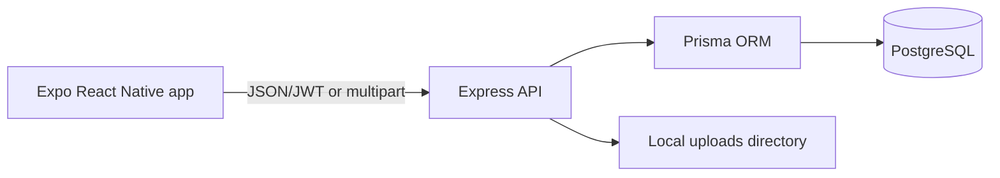

# MiniLedger

MiniLedger is a small full-stack mobile app for tracking money lent to friends. It uses a real Express API and PostgreSQL database; the mobile client does not contain hardcoded loan data.

## Features

- Mock phone-number + OTP login (OTP is printed by the backend)
- JWT-protected loan APIs
- Create, list, inspect, and repay loans
- Database-backed summary totals and date-only overdue calculation
- Receipt image uploads stored locally during development
- Expo mobile client with secure token storage
- OpenAPI documentation and Jest/Supertest tests

## Technology

Node.js, TypeScript, Express, Prisma, PostgreSQL, Zod, JWT, Multer, Jest, Supertest, React Native, Expo SDK 58, React Navigation, Axios, Expo SecureStore, and Expo Image Picker.

## Architecture



## Prerequisites

- Node.js 20 or newer
- PostgreSQL 14 or newer, or Docker Desktop
- Expo Go on a phone, or an Android/iOS simulator

## Run locally on Windows

### 1. Start PostgreSQL

The easiest local setup is Docker Desktop. Start Docker Desktop, then run this once from PowerShell:

```powershell
docker run --name miniledger-postgres `
  -e POSTGRES_USER=postgres `
  -e POSTGRES_PASSWORD=postgres `
  -e POSTGRES_DB=miniledger `
  -p 5432:5432 `
  -d postgres:16
```

If the container already exists, start it with:

```powershell
docker start miniledger-postgres
```

You can confirm it is running with:

```powershell
docker ps
```

### 2. Configure and start the backend

From PowerShell at the repository root, create the local environment file:

```powershell
Copy-Item backend\.env.example backend\.env
```

If you use the Docker command above, the default `DATABASE_URL` in `backend\.env` is already correct. Change `JWT_SECRET` to a long random value before using the app.

Open a new PowerShell window and run:

```powershell
Set-Location D:\projects\miniledger\backend
npm install
npx prisma generate
npx prisma migrate dev --name init
npm run dev
```

The API runs at [http://localhost:4000](http://localhost:4000). Verify it with:

```powershell
Invoke-RestMethod http://localhost:4000/api/health
```

Swagger UI is available at [http://localhost:4000/api/docs](http://localhost:4000/api/docs).

### 3. Start the mobile app

Open a second PowerShell window:

```powershell
Set-Location D:\projects\miniledger\mobile
npm install
npx expo start --web
```

Expo displays a local URL. Open it in your browser, usually [http://localhost:8081](http://localhost:8081). If port 8081 is busy, use the alternate port shown by Expo.

To run on a phone or emulator instead, use:

```powershell
npx expo start
```

For a physical phone, set `EXPO_PUBLIC_API_URL` to the computer's LAN address, for example `http://192.168.1.20:4000/api`, rather than `localhost`. The phone and computer must be on the same Wi-Fi network.

### 4. Sign in

1. Enter a 10-digit phone number.
2. Select **Send OTP**.
3. Copy the six-digit OTP printed in the backend terminal.
4. Enter the OTP and select **Verify OTP**.

The dashboard lets you add, view, repay, and attach receipts to loans. Due dates can be entered as `DD-MM-YYYY` or `YYYY-MM-DD`.

### Stop the project

Stop the backend and Expo terminals with `Ctrl+C`. Stop PostgreSQL when needed with:

```powershell
docker stop miniledger-postgres
```

To start it again later:

```powershell
docker start miniledger-postgres
```

## Project structure

| Directory | Description |
| --- | --- |
| `backend/` | Express API, Prisma schema, migrations, and tests |
| `mobile/` | Expo SDK 58 React Native app |
| `docs/` | API reference and interview preparation notes |

### Authentication note

Authentication is deliberately mocked for development. The OTP is printed in the backend terminal; it is not sent by SMS and does not verify phone ownership. A production deployment should replace this flow with an SMS provider and add persistent OTP storage, rate limiting, and stronger account controls.

## Run tests and builds

```powershell
# Backend tests
Set-Location D:\projects\miniledger\backend
npm test

# Backend production build
npm run build

# Mobile type check
Set-Location D:\projects\miniledger\mobile
npx tsc --noEmit

# Expo project checks
npx expo-doctor
```

Tests use an in-memory fake Prisma client and do not delete development data. The API code still uses Prisma in normal runtime.

## Example API requests

```powershell
$body = @{ phone = "9876543210" } | ConvertTo-Json
Invoke-RestMethod http://localhost:4000/api/auth/send-otp -Method Post -Body $body -ContentType "application/json"
```

See [docs/API.md](docs/API.md) for the complete endpoint reference.

## Environment variables

See [backend/.env.example](backend/.env.example). Never commit `.env`, JWT secrets, database credentials, or uploaded receipts.

## Known limitations and future improvements

Local receipt storage is intended for development and is not durable across servers. OTPs are stored in process memory and printed to the console, so restarting the API clears them. A production version should use an SMS provider, Redis-backed rate limits/OTP storage, object storage, refresh tokens, stronger account controls, and a database-backed test environment.

## Interview preparation

See [docs/INTERVIEW_PREP.md](docs/INTERVIEW_PREP.md) for the architecture explanation, security decisions, debugging scenarios, and interview questions.
