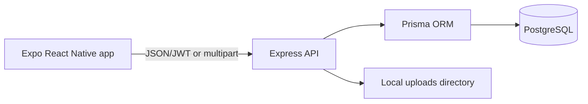

# MiniLedger

MiniLedger is a small full-stack mobile app for tracking money lent to friends. It uses a real Express API and PostgreSQL database; the mobile client does not contain hardcoded loan data.

## Features

- Mock phone-number + OTP login (OTP is printed by the backend)
- JWT-protected loan APIs
- Create, list, inspect, and repay loans
- Database-backed summary totals and date-only overdue calculation
- Receipt image uploads stored locally during development
- Expo mobile client with secure token storage
- OpenAPI documentation and Jest/Supertest tests

## Technology

Node.js, TypeScript, Express, Prisma, PostgreSQL, Zod, JWT, Multer, Jest, Supertest, React Native, Expo SDK 58, React Navigation, Axios, Expo SecureStore, and Expo Image Picker.

## Architecture



## Prerequisites

- Node.js 20 or newer
- PostgreSQL 14 or newer
- Expo Go on a phone, or an Android/iOS simulator

## Setup

From PowerShell at the repository root:

```powershell
Copy-Item backend\.env.example backend\.env
# Edit backend\.env and set DATABASE_URL and JWT_SECRET
Set-Location backend
npm install
npx prisma generate
npx prisma migrate dev --name init
npm run dev
```

The API runs at `http://localhost:4000`. Swagger UI is at `http://localhost:4000/api/docs`.

For a physical phone, set `EXPO_PUBLIC_API_URL` to the computer's LAN address, for example `http://192.168.1.20:4000/api`, rather than `localhost`.

In another PowerShell window:

```powershell
Set-Location mobile
npm install
npx expo start
```

## Testing OTP login

1. Enter a 10-digit phone number in the app.
2. Press **Send OTP**.
3. Read the six-digit OTP printed in the backend terminal.
4. Enter it and press **Verify OTP**.

This is deliberately mock authentication. It proves the application flow but is not phone ownership verification and must be replaced by an SMS provider in production.

## Tests

```powershell
Set-Location backend
npm test
```

Tests use an in-memory fake Prisma client and do not delete development data. The API code still uses Prisma in normal runtime.

## Example API requests

```powershell
$body = @{ phone = "9876543210" } | ConvertTo-Json
Invoke-RestMethod http://localhost:4000/api/auth/send-otp -Method Post -Body $body -ContentType "application/json"
```

See [docs/API.md](docs/API.md) for the complete endpoint reference.

## Environment variables

See [backend/.env.example](backend/.env.example). Never commit `.env`, JWT secrets, database credentials, or uploaded receipts.

## Known limitations and future improvements

Local receipt storage is intended for development and is not durable across servers. OTPs are stored in process memory and printed to the console, so restarting the API clears them. A production version should use an SMS provider, Redis-backed rate limits/OTP storage, object storage, refresh tokens, stronger account controls, and a database-backed test environment.

## Interview preparation

See [docs/INTERVIEW_PREP.md](docs/INTERVIEW_PREP.md) for the architecture explanation, security decisions, debugging scenarios, and interview questions.
